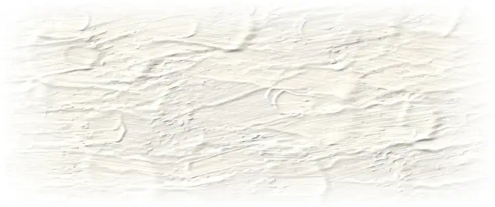
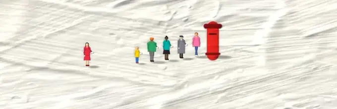
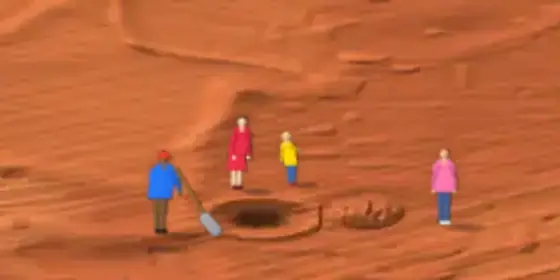
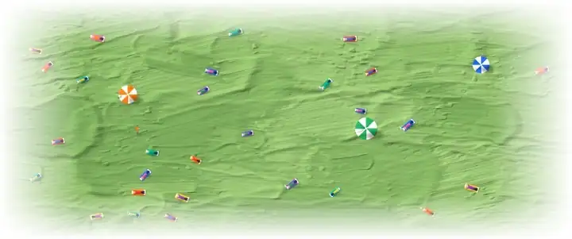

# Plaster art with small figures: research and prototypes

**TLDR**
1. **Found:** his grounds are thick acrylic gel spread with a knife, not plaster, and only the snow works are white. The figures are tiny, painted last, often in crowds.
2. **Recommend:** moving plaster scenes where the figures act out the page: the 404 first, then empty filters, then /contact. Smooth, transform-only motion that stops when off screen and is a still picture with reduced motion on.
3. **Your decision:** white plaster everywhere (quiet), or a coloured ground per section (louder, ties to the section colours).

On the preview, in place on the real pages (branch only, production untouched): [/contact](https://aayushmanchandacom-git-claude-vibrant-dirac-ugx6fd-vettedinc.vercel.app/contact) · [/library](https://aayushmanchandacom-git-claude-vibrant-dirac-ugx6fd-vettedinc.vercel.app/library) · [any missing URL for the 404](https://aayushmanchandacom-git-claude-vibrant-dirac-ugx6fd-vettedinc.vercel.app/this-page-does-not-exist). The empty filter, the ground study and all four side by side: [/lab/plaster](https://aayushmanchandacom-git-claude-vibrant-dirac-ugx6fd-vettedinc.vercel.app/lab/plaster). None of this exists on aayushmanchanda.com itself. Vercel may ask you to log in.

## The four scenes, moving

| 404: walks in on their own footprints, stops, reads the map | Contact: the queue shuffles up, posts, walks off |
|---|---|
|  |  |
| **Empty filter: keeps digging, nothing comes up, they keep watching** | **Library: pages turn, one more reader walks across** |
|  |  |

The 404 walk plays once (12 s), then the figure stays, lowering the map to look around every 7 s. The other three loop. Both themes, phone and desktop, in `screenshots/`; the ground study is `screenshots/grounds.webp`.

## 1. The art

Every source below is a search-result snippet. The artist's site, the galleries and the press were blocked by this cloud session's network policy (WebFetch and the browser both refused), so no page was read in full and no image was viewed.

| What | Finding | Source |
|---|---|---|
| Ground | Acrylic and acrylic gel on canvas, "sculptural paint, volcanic ash, and marble dust" | [Dellasposa](https://www.dellasposa.com/artworks/4271-werner-bronkhorst-all-downhill-from-here-2022/), [Ocula, Bath Salt](https://ocula.com/art-galleries/dellasposa/artworks/werner-bronkhorst/bath-salt/) |
| Plaster | Started with leftover plaster from furniture work, on wooden boards; now gel | [King Living](https://www.kingliving.com/blog/artist-werner-bronkhorst), [1stDibs](https://www.1stdibs.com/art/prints-works-on-paper/werner-bronkhorst-werner-bronkhorst-champions-large-wimbledon-series-sports-framed-2025/id-a_16677772) |
| Tool | Gel poured and spread with palette knives; he waits for "mountains, waves, or ice" to appear | [Colossal](https://www.thisiscolossal.com/2025/07/werner-bronkhorst-impasto-works/) |
| Figures | Painted last, on a dry ground, with a very small brush; small "to reflect how we all exist within something much bigger" | [What's On](https://whatson.ae/?p=377795) |
| Scale | Canvases 19 cm to 213 x 183 cm; one skier "smaller than your pinky nail" on the biggest; reads abstract from afar, figures appear up close | [Dellasposa](https://www.dellasposa.com/artworks/4271-werner-bronkhorst-all-downhill-from-here-2022/), [his TikTok](https://www.tiktok.com/@werner_bronkhorst/video/7503547341044059447), [Magzoid](https://magzoid.com/werner-bronkhorst-on-scaling-imagination-the-miniature-realms-and-monumental-vision/) |
| Grounds | White snow ([FairArt](https://fairart.com/artists/werner-bronkhorst)); "chunky blue expanses" of sea ([Colossal](https://www.thisiscolossal.com/2025/07/werner-bronkhorst-impasto-works/)); light-blue pool with red and white lanes ([his TikTok](https://www.tiktok.com/@werner_bronkhorst/video/7420780905217690885), [Pockies](https://us.pockies.com/pages/wet)); soft pink salt ([his TikTok](https://www.tiktok.com/@werner_bronkhorst/video/7521130121139440952)); rust clay, orange dunes, burgundy desert ([GQ Middle East](https://www.gqmiddleeast.com/article/werner-bronkhorst-brings-his-cult-art-practice-to-dubai-with-crack), [Emirates Woman](https://emirateswoman.com/inside-werner-bronkhorst-crack-a-new-exhibition-exploring-surfaces-pressure-and-place/)); green, purple and white colour fields after Rothko ([his TikTok](https://www.tiktok.com/@werner_bronkhorst/video/7613573194766683412)) | |
| Crowds | One figure, or many: thirteen players in The Champions, eight swimmers in Stay in Your Lane | [Artsy](https://www.artsy.net/artwork/werner-bronkhorst-the-champions-1), [Pockies](https://us.pockies.com/pages/wet) |
| Humour | Punning titles: All Downhill from Here, Tip of the Iceberg, Let's Clay | [printed-editions](https://www.printed-editions.com/artist/werner-bronkhorst/) |

**What makes it read:** a big field that looks abstract, knife ridges that catch a low light, and a few bright, flat-coloured figures at a scale that makes the field feel huge. The joke is in the title or the situation.

**Against your description** ("bright little people or objects on textured plaster or light/white backgrounds"): right about little bright people and texture, and objects do appear (umbrellas, boats, cars). Wrong on plaster (it's gel; plaster was only the start) and on white (only the snow series; most grounds are saturated colour). Not confirmed: whether figures cast painted shadows, and the light direction.

**Reuse:** no copyright or licensing statement found. He sells signed print editions (69, 169) and licenses brand work (Malbon Golf, Pockies shorts). Etsy is full of sellers offering paintings "in Werner Bronkhorst style" ([Etsy](https://www.etsy.com/market/werner_bronkhorst)), so the style is widely imitated; that is a reason to keep ours visibly different, not permission.

## How it's made

`feature-research/art-plaster/plaster.mjs`, plain Node, ~25 s for everything:
1. **Ground:** each knife stroke writes colour and paint height into a height field (flat middle, ridged edges, an arc where the knife lifts). A low light from the upper left reads the height, with shadows marched across it. Written as PNG by hand (`zlib`); the repo's existing `sharp` turns it into WebP.
2. **Figures:** drawn at 3x so they stay sharp when the browser scales them down. Real proportions: a head a seventh of the height, sloped shoulders, elbows, knees, shoes. Ten different people: coats, a dress, a skirt, shorts, a child, five skin tones, five hairstyles.
3. **Motion:** each moving thing is a small transparent strip of poses laid over the ground. `components/lab/Plaster.astro` turns the points in `plaster-manifest.json` into keyframes. Only `transform` and `opacity` animate.
4. **Rules it keeps:** a script arms the motion only when reduced motion is off, and pauses it whenever the scene is out of view. Without the script, or with reduced motion, each scene is a finished still (the queue stands in line; the 404 walker is already reading the map). Each theme downloads only its own pictures.

## Placements

| Rank | Page | What the figures do | KB per visit (light / dark) | Risk |
|---|---|---|---|---|
| 1 | **404** | Walk in on their own footprints, stop, read a map | 72 / 30 | Pushes the link list ~230px down on a phone (still above the fold at 375x812) |
| 2 | **Empty filters** (/tools, library pane, notes) | Keep digging, nothing comes up, a crowd watches | 33 / 22, only fetched once the empty message shows | Low: seen rarely |
| 3 | **/contact** | A queue at a red postbox; the frame is already a postage stamp | 110 / 68 | Heaviest: 7 people x 3 poses. A shared walking strip would halve it |
| 4 | **/library** | Readers on towels turn pages; one walks across | 56 / 24 | An index page; a picture above the list costs density |
| 5 | **/experiments** (not built) | Someone on a ladder looking over a tall ridge of paint | ~60 / ~25 | Crowds the status tally |

**Stay plain:** home, /tools and /sites indexes, notes, about, /now (already has the painted banner), /tokens, privacy, footer (every page pays), share cards (one change redraws 364), the ⌘K "No matches".

**Design rule change:** `design.md` §3 says /tokens and the /now banner are "the one place the site is loud on purpose". Shipping any of this adds a second family, and a moving one. I haven't edited `design.md`; the commit that ships the first scene should.

**Closeness check:** I couldn't view his images, so I checked against the descriptions. Changed: green, purple and white with a court line (matched "Get Served"), clay with a court line ("Let's Clay"), readers on a beach (his beachgoer theme, moved to a lawn). No skiers, surfers, lane swimmers or tennis.

## Speed, measured

Chrome trace, 4 s of each scene running at 1280px:
- **Repaints:** 8 in 4 s, the same as a page with no motion (the footer clocks). Under 3 ms of paint in total.
- **Frames:** 95th percentile 16.7 ms on every scene (60 fps). Worst single frame 50 ms, once, on the dig page.
- **Main thread:** about 0.2 ms of style work per frame while a scene runs. This isn't the scenes: the same test animation on `/about` or `/tools` costs the same, while on a blank page it costs nothing. Something in the site's shell takes animations off the compositor. Worth finding before more motion ships (the /tokens page would pay it too).

## Not verified

- Every claim under "The art" is from a search snippet. The artist's site, the galleries and image search were blocked by this session's network policy, so no source page or image was opened. Allowing `wernerbronkhorst.com`, `dellasposa.com`, `ocula.com`, `thisiscolossal.com` would fix it.
- Real devices: everything above is headless Chromium. Safari and iOS untested, including whether a hidden empty state skips its download (Chromium does).
- Sideways scroll at 320px: checked at 375 only. The site's `shoot.mjs` and `overflow.mjs` can't launch here (the repo pins a Playwright that doesn't match this container's browser), so I used my own script.
- The branch also puts the scenes on the real `/contact`, `/library` and 404 so they can be seen in place. That adds the scene script to those pages, so the signed-out JS check in `AGENTS.md` (byte-identical to main) would fail on this branch by design. It's one more reason not to merge it as is.
- Gates, run here on the final tree: `astro check` 0 errors, 0 warnings, 1 hint (the known baseline); `npm test` 736 pass; `npm run build` clean; `validate:schema` clean, image-budget within budget. The lab pages carry a one-node `WebPage` JSON-LD so the schema gate passes without an exemption.
