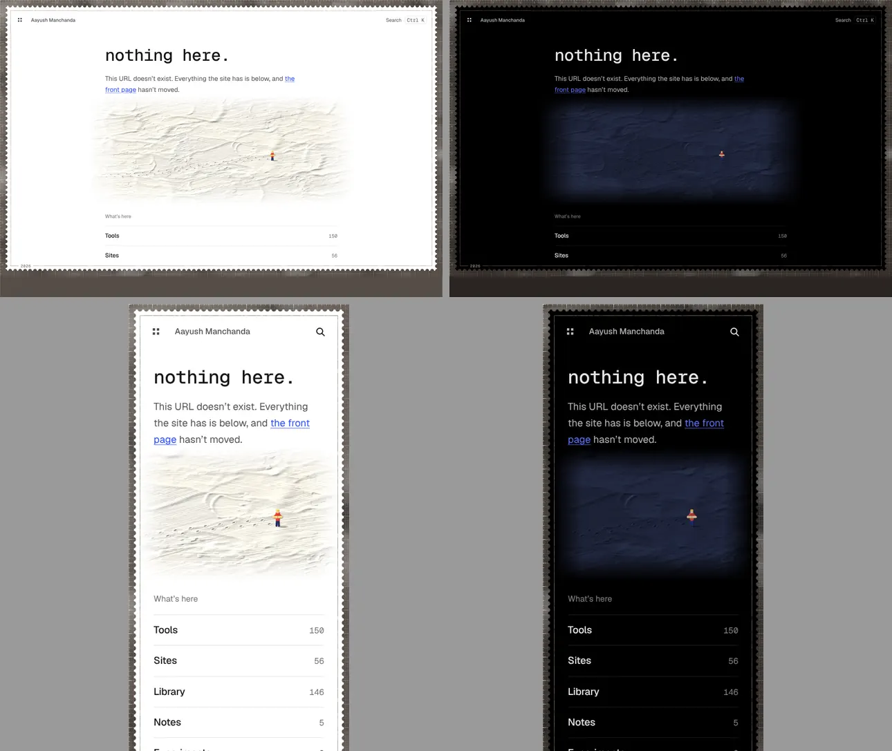
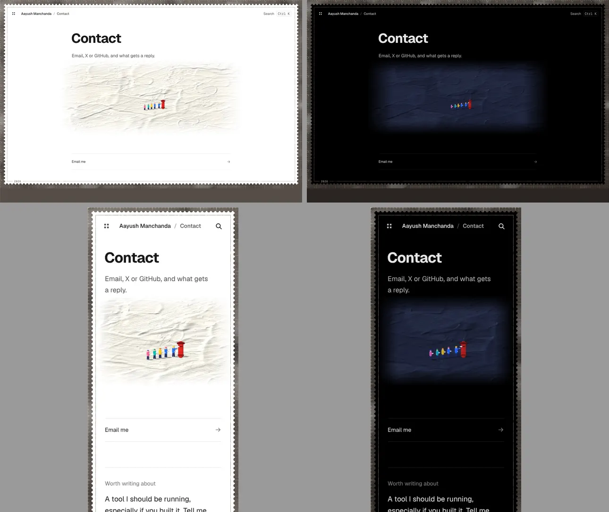
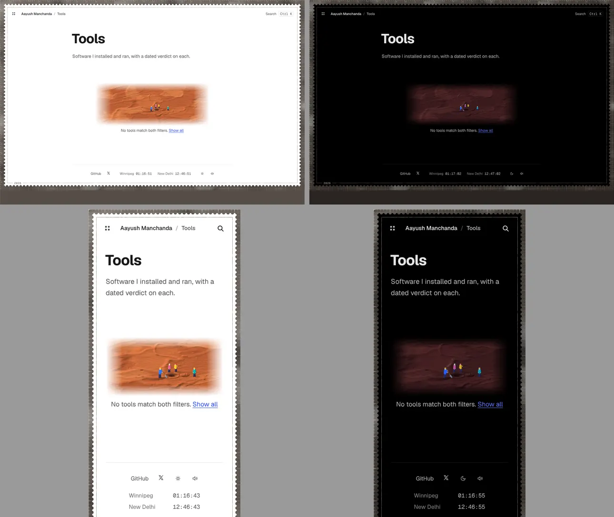
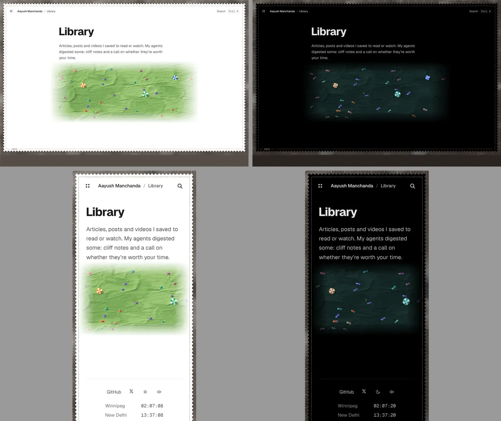
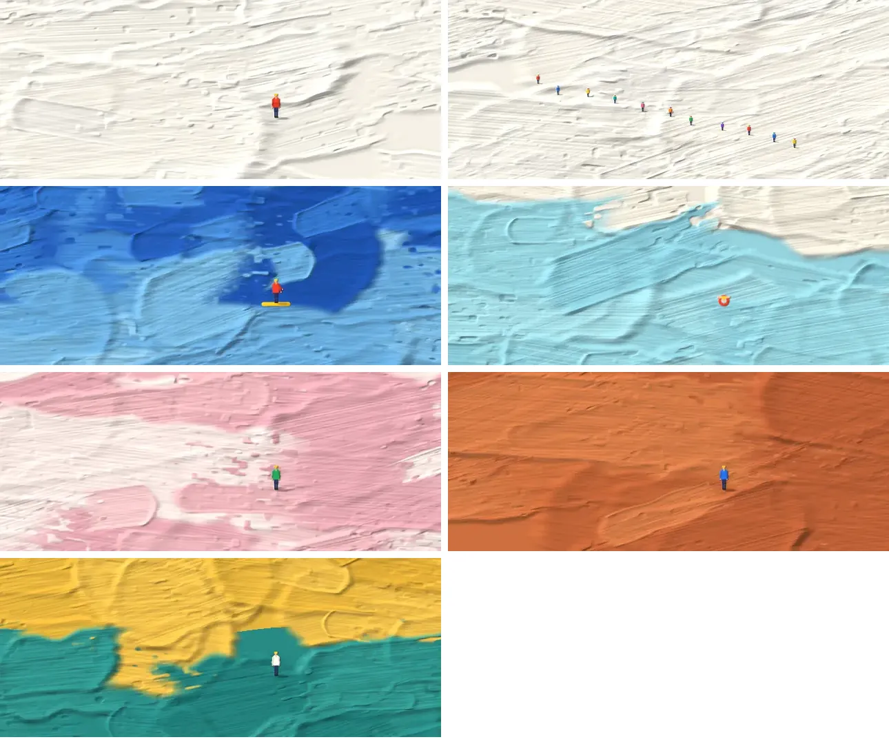

# Plaster art with small figures: research and prototypes

**TLDR**
1. **Found:** his grounds are thick acrylic gel knifed into ridges, not plaster, and only the snow works are white; others are sea blue, pool blue, salt pink, clay rust, colour fields. The figures are tiny and painted last.
2. **Recommend:** ship plaster scenes where a little figure explains the page: the 404, the empty filter states, then /contact. No motion, one static WebP per theme, 9 to 57 KB.
3. **Your decision:** white plaster everywhere (quiet, matches the white site), or a coloured ground per section (louder, ties to the section mats).

Previews (noindex, linked from nowhere): [index and grounds](https://aayushmanchandacom-git-claude-vibrant-dirac-ugx6fd-vettedinc.vercel.app/lab/plaster/) · [404](https://aayushmanchandacom-git-claude-vibrant-dirac-ugx6fd-vettedinc.vercel.app/lab/plaster/not-found/) · [contact](https://aayushmanchandacom-git-claude-vibrant-dirac-ugx6fd-vettedinc.vercel.app/lab/plaster/contact/) · [empty filter](https://aayushmanchandacom-git-claude-vibrant-dirac-ugx6fd-vettedinc.vercel.app/lab/plaster/empty/) · [library](https://aayushmanchandacom-git-claude-vibrant-dirac-ugx6fd-vettedinc.vercel.app/lab/plaster/library/). PR: [aayushmanchanda2/aayushmanchanda.com#81](https://github.com/aayushmanchanda2/aayushmanchanda.com/pull/81).

## 1. The art

Every source below is a search-result snippet. The artist's site, the galleries and the press were blocked by this cloud session's network policy (WebFetch and the browser both refused), so no page was read in full and no image was viewed.

| What | Finding | Source |
|---|---|---|
| Ground | Acrylic and acrylic gel on canvas, "sculptural paint, volcanic ash, and marble dust" | [Dellasposa](https://www.dellasposa.com/artworks/4271-werner-bronkhorst-all-downhill-from-here-2022/), [Ocula, Bath Salt](https://ocula.com/art-galleries/dellasposa/artworks/werner-bronkhorst/bath-salt/) |
| Plaster | Started with leftover plaster from furniture work, on wooden boards; now gel | [King Living](https://www.kingliving.com/blog/artist-werner-bronkhorst), [1stDibs](https://www.1stdibs.com/art/prints-works-on-paper/werner-bronkhorst-werner-bronkhorst-champions-large-wimbledon-series-sports-framed-2025/id-a_16677772) |
| Tool | Gel poured and spread with palette knives; he waits for "mountains, waves, or ice" to appear | [Colossal](https://www.thisiscolossal.com/2025/07/werner-bronkhorst-impasto-works/) |
| Figures | Painted last, on a dry ground, with a very small brush; small "to reflect how we all exist within something much bigger" | [What's On](https://whatson.ae/?p=377795) |
| Scale | Canvases 19 cm to 213 x 183 cm; one skier "smaller than your pinky nail" on the biggest; reads abstract from afar, figures appear up close | [Dellasposa](https://www.dellasposa.com/artworks/4271-werner-bronkhorst-all-downhill-from-here-2022/), [his TikTok](https://www.tiktok.com/@werner_bronkhorst/video/7503547341044059447), [Magzoid](https://magzoid.com/werner-bronkhorst-on-scaling-imagination-the-miniature-realms-and-monumental-vision/) |
| Grounds | White snow ([FairArt](https://fairart.com/artists/werner-bronkhorst)); "chunky blue expanses" of sea ([Colossal](https://www.thisiscolossal.com/2025/07/werner-bronkhorst-impasto-works/)); light-blue pool with red and white lanes ([his TikTok](https://www.tiktok.com/@werner_bronkhorst/video/7420780905217690885), [Pockies](https://us.pockies.com/pages/wet)); soft pink salt ([his TikTok](https://www.tiktok.com/@werner_bronkhorst/video/7521130121139440952)); rust clay, orange dunes, burgundy desert ([GQ Middle East](https://www.gqmiddleeast.com/article/werner-bronkhorst-brings-his-cult-art-practice-to-dubai-with-crack), [Emirates Woman](https://emirateswoman.com/inside-werner-bronkhorst-crack-a-new-exhibition-exploring-surfaces-pressure-and-place/)); green, purple and white colour fields after Rothko ([his TikTok](https://www.tiktok.com/@werner_bronkhorst/video/7613573194766683412)) | |
| Crowds | One figure, or many: thirteen players in The Champions, eight swimmers in Stay in Your Lane | [Artsy](https://www.artsy.net/artwork/werner-bronkhorst-the-champions-1), [Pockies](https://us.pockies.com/pages/wet) |
| Humour | Punning titles: All Downhill from Here, Tip of the Iceberg, Let's Clay | [printed-editions](https://www.printed-editions.com/artist/werner-bronkhorst/) |

**What makes it read:** a big field that looks abstract, knife ridges that catch a low light, and a few bright, flat-coloured figures at a scale that makes the field feel huge. The joke is in the title or the situation.

**Against your description** ("bright little people or objects on textured plaster or light/white backgrounds"): right about little bright people and texture, and objects do appear (umbrellas, boats, cars). Wrong on plaster (it's gel; plaster was only the start) and on white (only the snow series; most grounds are saturated colour). Not confirmed: whether figures cast painted shadows, and the light direction.

**Reuse:** no copyright or licensing statement found. He sells signed print editions (69, 169) and licenses brand work (Malbon Golf, Pockies shorts). Etsy is full of sellers offering paintings "in Werner Bronkhorst style" ([Etsy](https://www.etsy.com/market/werner_bronkhorst)), so the style is widely imitated; that is a reason to keep ours visibly different, not permission.

## 2. How the prototypes are made

`feature-research/art-plaster/plaster.mjs`, plain Node, about 20 s for all 15 pictures:
1. Each knife stroke writes colour and paint height into two fields: flat in the middle, a ridge along both edges, an arc-shaped lip where the knife lifts, streaks along its length, skips where older paint shows.
2. A low light from the upper left reads the height: slope shading, a little gloss, darker crevices, and shadows marched across the height so ridges shade what's behind them.
3. Figures go on last as small raised dabs with a painted shadow.
4. The PNG is written by hand with `zlib`. `sharp` (already a dev dependency) re-encodes it to WebP.

Every scene has a night version (the same plaster in slate under moonlight), so the dark theme gets no white slab. Each theme fetches only its own file, the same CSS-variable trick as the /tokens sky. The plaster fades into the page at its edges, so there's no frame and no outline.

## 3. Placements

| Rank | Page | Idea | Build | Added KB (day / night, one per visit) | Motion | Risk |
|---|---|---|---|---|---|---|
| 1 | **404** | Footprints cross the plaster and stop at one figure reading a map. Nothing ahead. | Static WebP, CSS background | 56 / 15 | None | Pushes the link list about 230px down on a phone (still above the fold at 375x812); the 404's job is the list |
| 2 | **Empty filters** (/tools, library pane, notes) | A hole dug in clay, nothing in it, four people looking anyway | Static WebP, loads only when the empty message shows | 20 / 9 | None | Low. Seen rarely |
| 3 | **/contact** | A queue of five at a red postbox, the front one posting. The frame is already a postage stamp | Static WebP | 58 / 16 | None | Sits above the Email row; could go below it instead |
| 4 | **/library** | 28 readers on towels on a lawn, three umbrellas | Static WebP | 53 / 21 | None | An index page; a picture above the list costs density |
| 5 | **/experiments** (not built) | Someone on a ladder looking over a tall ridge of paint | Static WebP | ~50 / ~15 | None | Experiments has a status tally up top; crowding |

**Stay plain:** home (the hero and doodles carry it; a painting there makes the whole site loud), /tools and /sites indexes (dense tables and screenshots), notes (reading), about (photo and sparkle), /now (already has the painted banner), /tokens (already painted), privacy, the footer (every page pays the bytes), share cards (one change redraws 364; a picture fights the title at thumbnail size), the ⌘K "No matches" (too small to read).

**Design rule change:** `design.md` §3 says /tokens and the /now banner are "the one place the site is loud on purpose". Shipping any of this makes a second family: plaster scenes on recovery and contact surfaces. I haven't edited `design.md`, since nothing ships here; the line needs rewriting in the commit that ships the first one.

**Closeness check:** I couldn't view his images, so I checked against the descriptions. Two study tiles were too close and I changed them: green, purple and white with a court line matched "Get Served", and clay with a court line matched "Let's Clay". They're now mustard over teal and plain clay. The readers were going to be on a beach; moved to a lawn because aerial beach umbrellas are a beachgoer theme he's known for. No skiers, surfers, swimmers in lanes or tennis.

## 4. Prototypes

Routes, all `noindex`, out of the sitemap, linked from nowhere: `/lab/plaster` (index and the ground study), `/lab/plaster/not-found`, `/lab/plaster/contact`, `/lab/plaster/empty`, `/lab/plaster/library`. The contact and 404 previews are copies of the real pages plus one line, so the real pages are untouched.

Each sheet: desktop 1280 light and dark on top, phone 375 light and dark below. Headless Chromium.

| 404 | Contact |
|---|---|
|  |  |
| **Empty filter** | **Library** |
|  |  |

The ground study, the same method on seven grounds and at two scales (the far-off crowd is a third the size):

Measured on the built site: right picture per theme on all 30 loads, no sideways scroll at 375, no running animations with reduced motion on or off, no page errors. On a phone the picture zooms 1.5x around the figure so it stays about 25px tall; the readers stay whole because the crowd is the picture.

## 5. Not verified

- Every claim in §1 is from a search snippet; no source page or image was opened (network policy). Allowing `wernerbronkhorst.com`, `dellasposa.com`, `ocula.com`, `thisiscolossal.com` would fix that in a later session.
- Whether a hidden empty state skips its download in Safari and Firefox. In Chromium it does: measured, nothing fetched while hidden, fetched once shown. A dark visit fetches only the night file.
- iOS Safari and real devices: screenshots are headless Chromium.
- The Vercel preview: it was still building when this was written, and it may sit behind Vercel's login if the team has deployment protection on. Screenshots above are from the local build.
- Sideways scroll at 320px: checked at 375 only. The skill's `shoot.mjs` and `overflow.mjs` couldn't launch (the repo pins a Playwright that doesn't match this container's Chromium), so I used a small script on the preinstalled browser instead.
- Gates, run here on the final tree: `astro check` 0 errors, 0 warnings, 1 hint (the known baseline); `npm test` 736 pass; `npm run build` clean; `validate:schema` clean, image-budget within budget. The lab pages carry a one-node `WebPage` JSON-LD so the schema gate passes without an exemption.
